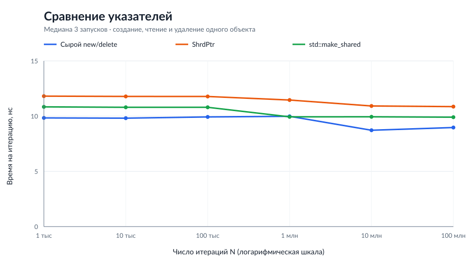

# ShrdPtr

Учебная реализация умного указателя с совместным владением на C++20. Несколько `ShrdPtr` могут ссылаться на один объект. Объект удаляется, когда исчезает последний владелец. Стандартный `std::shared_ptr` используется только в нагрузочном тесте для сравнения.

## Как устроено владение

Каждый `ShrdPtr<T>` хранит указатель на объект и указатель на общий `ControlBlock`. В блоке находятся число владельцев и функция удаления. Копирование увеличивает счётчик, перемещение передаёт владение без изменения счётчика, а уничтожение указателя уменьшает счётчик.

`MakeShrdPtr<T>(args...)` создаёт один `BlockWithObject<T>`: управляющие данные и сам объект находятся в одной аллокации. Указатель на функцию удаления сохраняет настоящий тип блока, поэтому `ShrdPtr<Derived>` можно скопировать в `ShrdPtr<Base>`, не потеряв правильное удаление `Derived`.

Для массивов есть `ShrdPtr<T[]>` и `MakeShrdArray<T>(size)`. `BlockWithArray<T>` хранит отдельно выделенный массив и при удалении последнего владельца вызывает `delete[]` для всех его элементов.

## Сборка и тесты

Нужны компилятор с поддержкой C++20 и `make`. Все команды выполняются из корня проекта.

| Команда | Что делает |
| --- | --- |
| `make all` | Собирает три отдельные программы в `build/`. |
| `make test` | Собирает и запускает функциональные тесты из `tests/tests.cpp`. |
| `make leak-demo` | Запускает `tests/with_leaks.cpp`: два объекта удерживают друг друга сильными ссылками. |
| `make load` | Запускает `tests/load.cpp` и печатает CSV с замерами времени. |
| `make plot` | Запускает нагрузочный тест три раза и обновляет данные и график в `docs/`. Нужен Python 3; дополнительные пакеты не требуются. |
| `make clean` | Удаляет результаты сборки из `build/`. |

Функциональные тесты проверяют создание, пустой указатель, копирование, перемещение, присваивание, преобразование к базовому классу и работу с массивом. Для массива отдельно проверяется, что все элементы уничтожаются после последнего владельца. Если какая-либо проверка выводит `[FAIL]`, `make test` завершается с ошибкой.

### Проверка под Valgrind

После `make all` программы можно запустить из терминала под установленным Valgrind:

```bash
valgrind --leak-check=full --show-leak-kinds=all ./build/functional_tests
valgrind --leak-check=full --show-leak-kinds=all ./build/leak_demo
```

Обе команды показывают отчёт об утечках. Во втором запуске утечка **ожидаема**: `A` владеет `B`, а `B` владеет `A`, поэтому счётчик каждого не достигает нуля. Нагрузочный тест под Valgrind не подходит для сравнения времени: инструмент замедляет выполнение программы.

## Сравнение времени



[Исходные данные графика](docs/benchmark.csv) — медиана трёх запусков на этой машине, `g++ 14.2.0`, `-O2`. На графике показано время одной итерации в наносекундах для `N` от 1 000 до 100 000 000. Малые значения `N` исключены из графика из-за шума таймера, но сохранены в CSV.

В каждой итерации создаётся один `int`, читается его значение и объект освобождается. Одновременно жив только один объект. Сравниваются обычные `new/delete`, `MakeShrdPtr` и `std::make_shared`. Во всех трёх циклах адрес записывается в `volatile` переменную, чтобы компилятор не убрал аллокацию сырого указателя. `MakeShrdPtr` делает одну аллокацию; используемая здесь реализация `std::make_shared` обычно тоже одну.

Для повторения измерений выполните `make plot`. Результаты зависят от компилятора и компьютера; этот тест измеряет время, а не потребление памяти.
